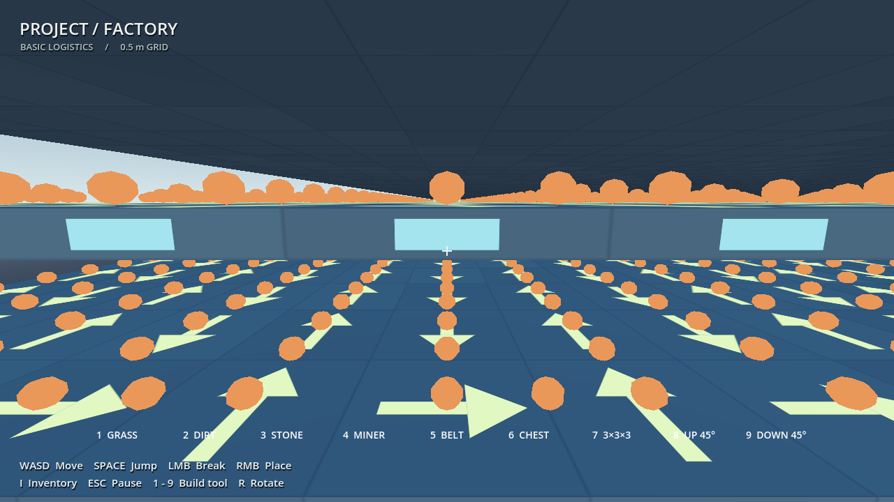
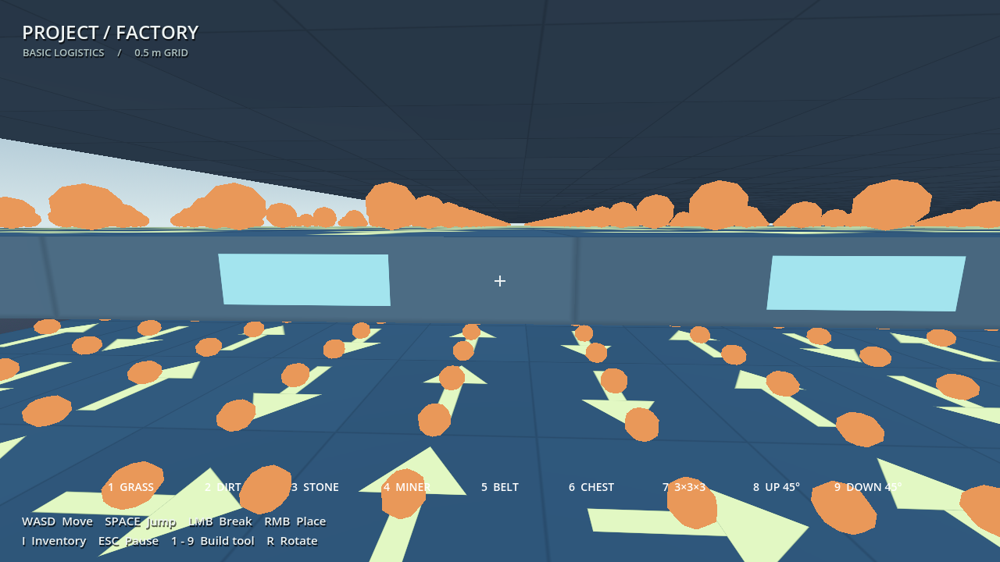
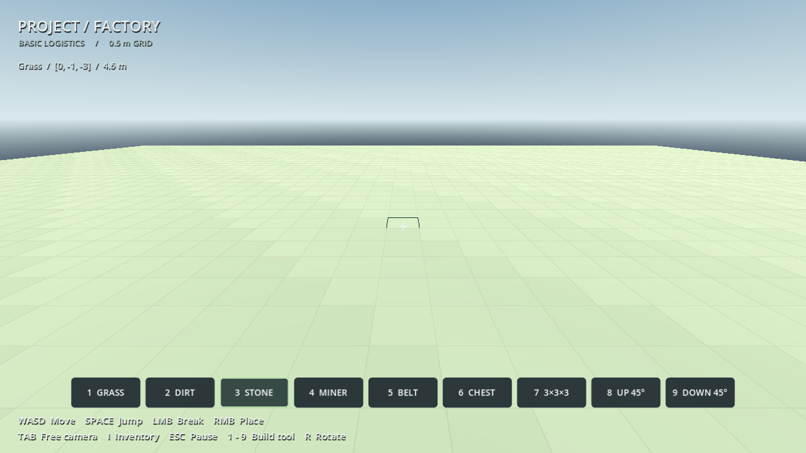

# 2026-11-23：候选缓存、矿石批量上传与 Rust 顺序读取

读者：接入开发者、测试与审查人员。范围：在游戏基线 `ed72f1f` 和
RustConveyor 基线 `a95b93a` 上实施的三项优化。
状态：实现、完整回归、原生图形检查、百万固定／移动窗口及候选重放通过；
独立实现审查无阻断缺陷。编辑器启动验收与退出限制见下文。
规则入口为 [002 接入规格](../features/prealpha-2/002-rust-conveyor-integration.md#候选复用批量上传与顺序读取)。

## 实现与首轮证据

候选以相机位置为锚点，预取覆盖 0.5 米位移的扩展球。静止／原地转动复用
完整选择；小幅平移保留保守内球，只精确检查边界。最低矿石高度及设备
显示节点按设施缓存，矿石位置和库存仍读取当前帧。编辑、恢复、重绑、
相机切换及非法参数使选择失效。实际候选查询计数每显示帧清零，避免缓存命中
时把上一帧工作误记为当前工作。

每批每帧只计算一次逆变换。安装扩展时由原生显示辅助按 12 浮点 3D 布局
上传 MultiMesh 完整容量缓冲区；默认后端或旧扩展使用引擎逐实例提交。
可见数量和自定义 AABB 只覆盖有效前缀，包围盒留浮点舍入余量；
保留稳定矿石身份与批次容量复用。`batch_uploads` 计批次提交，
`buffer_uploads` 只计实际成功的原生批量上传。

Rust 只遍历有限页相交的队列子树／叶块，返回时按旧前缀算法顺序合并补偿距离。
连续请求的每行均未截断时共享一次区间遍历；任一行截断时保留独立有限页，
不读取其被截断尾部。精确 ordinal 继续决定行归属，懒标记不被物化。
减少树读取不等于严格线性 CPU：祖先前缀改写仍存在 `O(K log B)` 算术工作。

首轮日志保存在 RustConveyor `.tmp/`，为工具产生的临时证据：

- `sequential-red.log`：有限页输出正确，但 1,024 件矿石发生 28,631 次节点访问，
  访问量断言正确失败。实现后该测试通过，节点访问少于 300，叶块少于 30，
  物品记录访问少于 1,500；不据此推定整场景加速倍率。
- `sequential-precision.log`：混合补偿距离／懒压缩和不同局部区间的前缀
  main、correction 位级一致，读取后原记录与叶标记未变。
- `sequential-package-final.log`、`sequential-bridge.log`、
  `sequential-clippy.log`：44 项包契约、3 项桥接测试及 Clippy 通过。
- `display-optimization-red-corrected.log`：候选复用与每批上传计数缺失导致正确失败。
  初次 GPU getter 断言受 headless dummy renderer 限制，修正后不将此环境误作图形验收。
- `display-optimization-green.log`：24 项候选／批次／高度测试零错误、失败。
- `display-optimization-gpu.log`：独立 Metal 图形进程中的 6 项批次测试通过，
  包括实际 `MultiMesh.get_instance_transform` 的非单位 Basis 与世界位置。
  此证据验证上传数据；场景截图和测量期绘制另行验收。
- `display-optimization-types.log`：50 个业务脚本通过类型安全检查。

## 首轮独立审查

Rust 实现审查：Critical／Important 无。核对共享窗口归属、空行、零上限、
截断尾部、补偿与懒祖先求和。有限页测试补充了实际返回长度断言。
非二进制最小间距的专项补偿夹具属于可选建议，既有包契约继续覆盖实际配置。

Godot 实现审查：Critical 无，未发现实现阻断缺陷。完整回归与场景视觉验收
仍为未闭环的 Important 验收项；首轮测试副本比当前 `_clear()` 少三条缓存清理，
因此不能以首轮 GREEN 证明最终工作树。按建议继续增加位移预算等号／越界、
纵向／对角／往返路径以及 headless 缓冲区格式检查，最终重新验证。

## 批量提交修正与控制实验

初版 GDScript 缓冲区打包保留为失败尝试证据，未作为最终交付。
同一 Metal 进程以 14 批、每批 580 件、20 帧预热及 150 个交替顺序样本比较：
旧逐实例提交 p95 1.426 毫秒，GDScript 打包 2.328 毫秒
（`paired-upload-first.log`）。改用原生打包和包围盒合并后，
同进程旧路径 p95 2.784 毫秒、原生路径 0.560 毫秒
（`native-upload-paired.log`）。两次实验的旧路径也有明显时段差异；
只使用各实验内部的配对比较，不将微测量倍率视作整场景倍率。

新增接口先在旧库上正确失败（`native-upload-red.log`），随后 release 构建。
真实 GPU 首次发现 3 条包围盒包含断言失败（`native-upload-gpu.log`）：
Rust 与引擎转换求和顺序造成舍入差异。增加坐标尺度相关的保守余量后，
7 项 Metal 测试及直接桥接契约通过
（`native-upload-gpu-v2.log`、`native-upload-gpu-smoke.log`）。
备用路径单独验证；最终计量区分原生缓冲区上传和批次提交，
使测试不能靠备用路径代替原生路径成功。

Rust 控制实验在源码工作副本中比较原来的身份／前缀逐项读取与当前区间读取；
实验夹具未加入业务源码。百万队列的 300 个相邻两件区间，
fresh／阻塞 120 tick 后的配对 p95 分别由 0.884／0.898 毫秒降至
0.612／0.619 毫秒（`finite-query-paired-v3.log`）。
另外显式覆盖根节点／右子树的懒标记，2、74、4,096 件有限页均位级匹配旧前缀，
配对 p95 均下降（`finite-query-lazy-paired.log`）。
这些结果排查了短行与懒标记的具体回退疑虑，仍不能代替百万整场景复测。

本次原生辅助独立审查没有 Critical；Important 为最终舍入修正的图形复验和
有限读取实际 CPU 对照。上述证据补齐这两项；完整回归与场景测量另列。

## 最终代码回归

`native-upload-full-verify.log`：442 项游戏测试零错误、失败、跳过和孤儿，
50 个业务脚本类型安全检查通过；原生运输、12 类宿主回归和显示契约通过，
前后跨进程启动、120 帧主场景、原项目缓存及 diff 检查通过。
底层日志目录由本次工具输出记录，不作为长期环境配置。

`native-upload-final-gpu.log`：最终提交计数修正后的 7 项 Metal 测试通过，
实际原生成功上传计数与批次数相符，强制备用路径的原生上传数为零。
`native-upload-rust-tests.log`、`native-upload-clippy.log`：208 项核心测试、
3 项桥接测试及严格 Clippy 通过，包含 44 项包契约。

## 首轮整场景回退与最终固定窗口

初次优化窗口 `.tmp/pf_display_reuse_fixed_20261123` 的帧 CPU／帧间隔
p95 为 80.587／105.361 毫秒，明显慢于基线 46.269／48.358 毫秒，
因此未接受该结果。其候选和静态准备已经下降，但 GDScript 打包提交变慢；
未改的核心、三维转换及映射阶段也明显变慢，不能将全部差异归于打包，
也未确认其环境原因。保留原窗口和上述配对实验作为回退证据。

最终原生上传版本 `.tmp/pf_display_reuse_fixed_20261123_v2` 在同一
Apple M4 Pro、Godot 4.7.2、Forward Plus／Metal 前台图形窗口运行，
预热 120 tick 后测量 300 tick，实际绘制 300 帧，人口审计／报告写入
位于计时窗外。未改核心 p95 为 0.034375 毫秒，基线为 0.033625 毫秒；
三维转换／映射为 0.344959／0.875 毫秒，基线为 0.336958／0.867 毫秒。
这些相邻控制阶段接近，最终窗口无需依靠首轮普遍变慢的样本作比较。

固定窗口帧 CPU p95 降到 21.752 毫秒，帧间隔降到 23.636 毫秒。
候选／静态准备为 0.004／0.021 毫秒；热缓存每帧精确距离检查、
候选重建与静态元数据准备均为零。Rust 查询为 9.616167 毫秒，
提交为 6.656 毫秒。每帧 14 次逆变换、14 次成功原生缓冲区上传。
移动窗口、逐 tick 工作量对照、来源指纹和 RSS 的综合验收见最终结果。

## 百万综合验收

三窗口均为 1,016,188 条带、62 个坡道、4 段原生运输、4 台矿机及 1 个箱子。
固定优化窗口与基线的 300 个 tick 逐行一致：11,569 个候选、
4,050 个显示行、8,096～8,098 件显示矿石、每帧 108 次原生查询、
零显示错误，Rust 数量、成交累计与几何绑定计数也一致。
三窗口人口均从 2,032,384 增至 2,032,404；带上人口保持 2,032,375，
测量期生产／消耗／跨段交接分别为 20／20／30。

下表时间均为毫秒 p95；RSS 为完整进程峰值，首次绑定与挂载为单次秒数。
移动窗口的候选范围随轨迹变化，只与固定窗口并列展示，不作为相同显示工作量
的前后倍率。固定帧 CPU 降低 53.0%，帧间隔降低 51.1%，Rust 查询降低 30.5%；
所有样本仍超过 16.67 毫秒帧预算，尚未达到稳定 60 FPS。

| 指标 | 基线固定 | 优化固定 | 优化小幅移动 |
| --- | ---: | ---: | ---: |
| 候选筛选 | 6.962 | 0.004 | 0.421 |
| 静态表现准备 | 11.491 | 0.021 | 7.459 |
| Rust 显示查询 | 13.839792 | 9.616167 | 8.999458 |
| 采样及三维转换合计阶段 | 17.267 | 12.950 | 12.138 |
| 提交 | 7.560 | 6.656 | 6.478 |
| 帧 CPU | 46.269 | 21.752 | 28.234 |
| 帧间隔 | 48.358 | 23.636 | 30.015 |
| 首次几何绑定（秒） | 1.073350 | 1.071284 | 1.064475 |
| 主场景挂载（秒） | 23.346318 | 23.127769 | 23.017630 |
| 峰值 RSS（GiB） | 13.9354 | 14.1626 | 14.1431 |

本轮没有取得内存或首次挂载的明确收益；RSS 还包含压力档生成、存读档及挂载，
不能将约 0.23 GiB 的差异归为候选缓存净增量。绑定、核心和三维转换为嵌套计时，
不能与采样阶段相加；总帧与帧间隔均来自独立原始样本。

移动轨迹按规格连续平移与转动。每帧保留 10,344 个内球设施，
精确检查 2,521 个边界候选，测量窗无候选重建；新进入设施使静态元数据
准备数为 0～13，候选变动仍会刷新设备表现，故静态准备不等于固定窗口的零成本。
显示候选为 11,030～11,696，行数为 3,882～4,082，矿石为 7,761～8,162；
区块批次切换时逆变换和成功原生上传均为 13～14。

`moving-candidate-oracle.log` 输出
`MOVING_CANDIDATE_ORACLE_PASS frames=420 measured_counter_matches=300`。
参考从完整世界的 1,016,193 座设施独立枚举，以三角不等式确定的 14,240 个
参考候选逐帧直接筛选，核对缺失、多余、重复及记录中的候选／复用计数。
该检查证明固定夹具的距离候选正确，不代替矿石渲染身份和像素级比较。

`display-reuse-analysis.log` 及 `display-reuse-analysis.json` 对应原始
`samples.json`、`work_samples.json` 与 `provenance.json`。
分析核对引擎、CPU、图形模式、轨迹、300 tick／绘制样本、逐行工作量及来源，
并从原始时间重算 p95／最大值。移动批次的 13～14 是进入／退出区块的实际结果，
分析器不再误要求移动窗口恒为 14 批。

固定／移动运行来自同一组实际输入：
游戏 `1b4043d04c86ef1024747e7797fc9272a77f9d3102f64de84225f1f3940053ce`；
原生构建 `5758cbc36570a8810898ceb5f6b68abddebf7068ce309e0aa518c8ce1b2495a8`；
加载库 `ccc4093005f9d441ba19441f6ff4d9d9fd6f06926d3b34d58f5903020e8be97d`。
release 清单的原生输入与采样时 Rust 源码一致；基线指纹保留在其原始来源报告，
不把之后的提交号当作当时加载库来源。

固定与移动截图均已检查，矿石、表面箭头和遮挡关系保持正常：

## 编辑器启动验收与限制

原延迟工具适配器返回未注册工具；后续通过本机认证的标准 MCP 会话完成实时验收，
未修改插件或机器配置。确认项目、Godot／插件版本和当前 `main.tscn`，
激活唯一会话；文件系统扫描完成，302 个全局类已注册。
从编辑器运行主项目，读取可见主菜单及命名对话框，通过按钮自身信号进入新世界，
读取运行树并检查游戏截图；本轮没有以此声称验证真实鼠标键盘派发。
初次启动回复的 3 秒 helper 等待窗未就绪，随后运行 UI 与截图成功。
验证结束停止游戏，实时状态确认 `is_playing=false`，之后关闭编辑器。

编辑器日志有 24 条警告，包括现有业务警告、局部名遮蔽及临时 eval 的动态类型警告；
游戏日志只有 helper 信息，运行期间没有错误。退出仍出现插件／编辑器
CanvasItem 1、ObjectDB 5 与 1 个在用资源提示；不能据此称编辑器全过程零错误。
此退出限制不影响独立百万进程、核心契约或完整验证的通过结果，
本轮没有排查插件退出资源的来源。证据为 `.tmp/editor-mcp-*.log`／JSON 和
`display-reuse-live-editor.log`。

## 最终独立审查

复审先读规格与测试，再检查两仓库实现、控制实验及候选参考程序。
Critical 无，未发现实现 Important 缺陷；Important 验收项为百万固定／移动、
420 帧重放、来源和最终文档，已按上述证据补齐。
可选建议为将非二进制最小间距的显式懒前缀夹具纳入正式测试；
不把现有 `0.25` 夹具说成覆盖所有浮点组合。
分析器元数据和重算百分位的可选建议已采纳。
最终证据／文档独立复审的 Critical、Important 均无，52 个本地链接与锚点通过；
百万数据、截图、编辑器告警及退出限制与原始证据相符，验收项已闭环。
